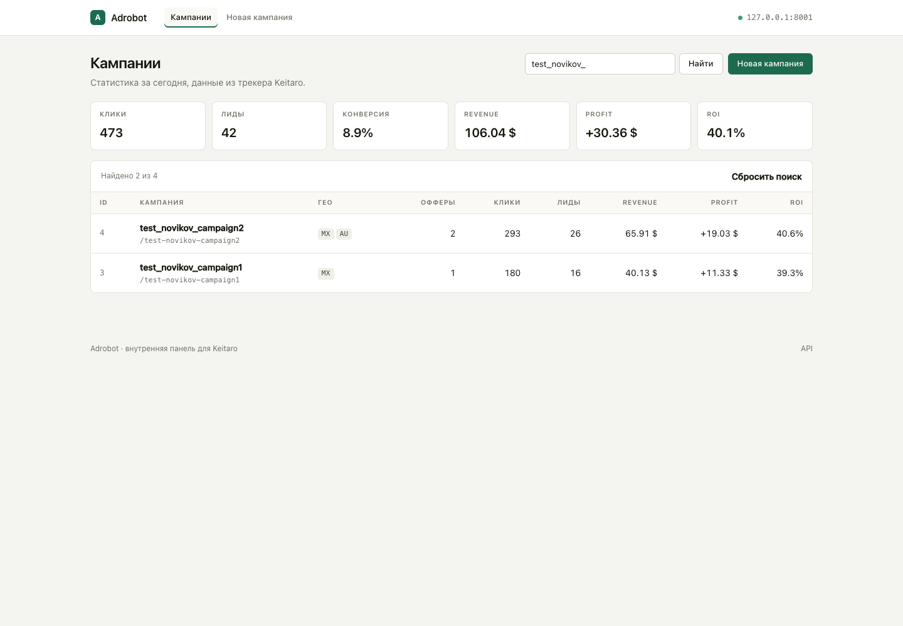
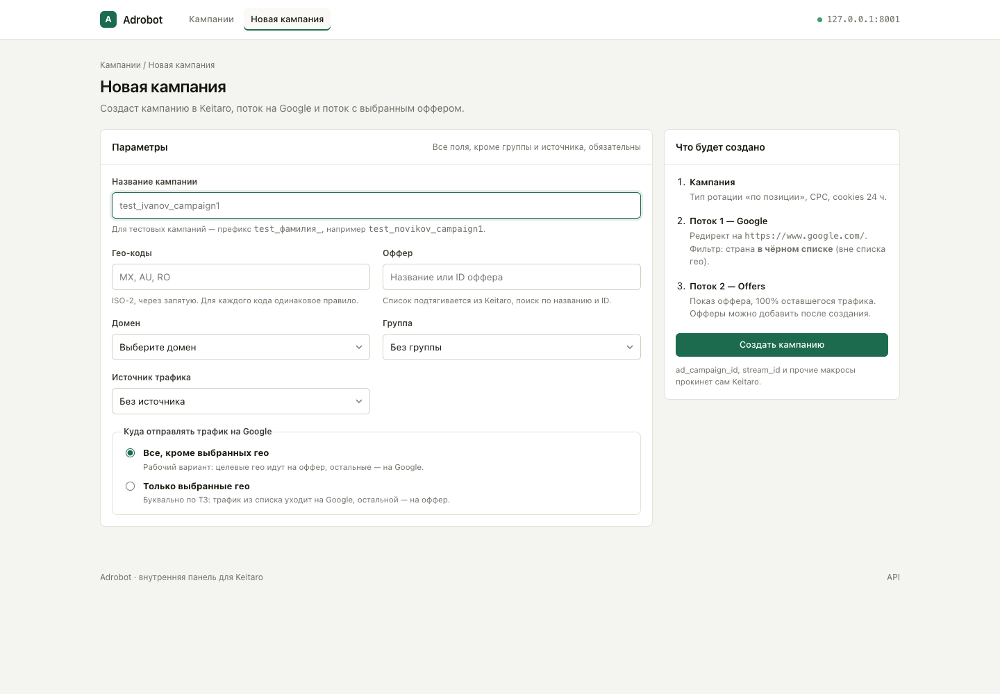
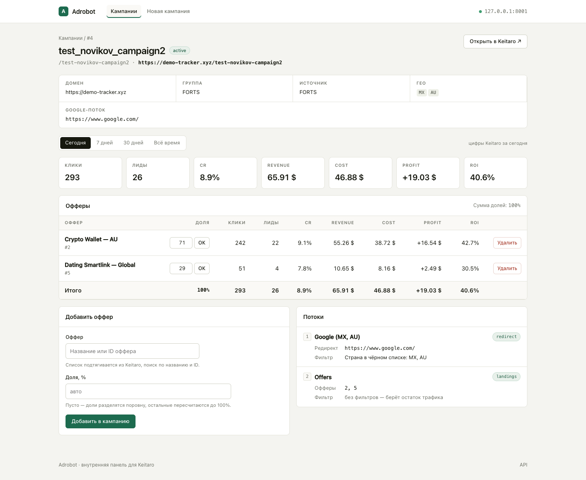

# Adrobot

Панель для работы с рекламным трекером **Keitaro**: создание кампаний «в один клик»
и редактор офферов внутри кампании. Тестовое задание: FastAPI + SQLAlchemy,
серверный рендеринг на Jinja2 + Alpine.js.



## Что умеет

**1. Создатель кампаний.** Принимает название, гео-коды и оффер, а также домен,
группу и источник трафика из справочников Keitaro. Создаёт в трекере:

- кампанию (ротация потоков «по позиции», CPC);
- поток №1 — редирект на Google с гео-фильтром;
- поток №2 — показ выбранного оффера (100% трафика).

Если второй поток создать не удалось, Adrobot удаляет уже созданную кампанию —
полуфабрикатов в трекере не остаётся.



**2. Редактор кампании.** Показывает потоки кампании и офферы с долями трафика и
живыми цифрами из Keitaro (клики, лиды, CR, revenue, cost, profit, ROI).
Умеет:

- добавлять оффер в поток и удалять его (нельзя удалить последний);
- менять долю оффера — остальные доли автоматически пересчитываются до 100%;
- переключать период статистики (сегодня / 7 дней / 30 дней / всё время).



Короткое демо сквозного сценария (22 секунды): [docs/demo.webm](docs/demo.webm) —
создание кампании, автокомплит оффера, добавление оффера, пересчёт долей и удаление.

## Быстрый старт

Нужен Python 3.11+.

```bash
git clone https://github.com/q133ss/Adrobot.git && cd Adrobot
python3 -m venv .venv
source .venv/bin/activate
pip install -e ".[dev]"

cp .env.example .env      # заполните KEITARO_BASE_URL и KEITARO_API_KEY
alembic upgrade head     # миграции
uvicorn app.main:app --reload
```

Откройте http://127.0.0.1:8000.

То же самое через `make`:

```bash
make install   # venv + зависимости
make migrate   # alembic upgrade head
make run       # uvicorn на :8000
```

### Демо без трекера

В репозитории есть фейковый Keitaro (in-process, повторяет используемый срез
Admin API). Чтобы посмотреть интерфейс без ключа:

```bash
KEITARO_DEMO=true uvicorn app.main:app --reload
```

Фейковый трекер уже наполнен доменами, группами, офферами и двумя кампаниями.
Его можно запустить и отдельным сервисом (тогда Adrobot ходит в него по HTTP,
как в настоящий Keitaro):

```bash
make fake   # http://127.0.0.1:8001, ключ demo-api-key
```

### Подключение реального Keitaro

1. В админке Keitaro: **Maintenance → Users → Admin API keys** (в некоторых
   версиях — **Account → API keys**). Там же вкладка **Documentation** — это
   Swagger, по нему удобно сверять поля.
2. Скопируйте ключ и адрес трекера в `.env`:

```dotenv
KEITARO_BASE_URL=https://your-tracker.xyz
KEITARO_API_KEY=ваш-ключ
```

3. Перезапустите приложение. Проверка связи: `GET /api/health`.

Требования Keitaro: тариф с Admin API, в трекере должны быть домен, группа,
источник трафика и офферы (их Adrobot показывает в селектах и автокомплите).

### Проверено на живом Keitaro

Сервис прогнан на реальном трекере (`https://tlgk.host`, 276 кампаний, 5550 доменов):
создание кампании через форму, оба потока, добавление/удаление офферов, изменение
долей и отчёты. По итогам проверки исправлены расхождения Swagger с реальным API:

- `GET /groups` требует обязательный параметр `type=campaigns|offers`;
- редирект — это `action_type=http`, а не `redirect`; поток с офферами
  (`schema=landings`) тоже принимает `http`;
- `POST /report/build` отдаёт `rows` объектами (без `meta`) — парсер поддерживает
  оба формата;
- у оффера `country` может быть пустой строкой или списком названий стран.

Тестовая кампания в трекере названа по правилу задания — `test_novikov_campaign1`
(префикс `test_фамилия_`), в форме создания и README есть подсказка об этом правиле.

## Переменные окружения

| Переменная | По умолчанию | Назначение |
| --- | --- | --- |
| `KEITARO_BASE_URL` | `http://127.0.0.1:8001` | Адрес трекера без `/admin_api/v1` |
| `KEITARO_API_KEY` | `demo-api-key` | Ключ Admin API |
| `KEITARO_TIMEOUT` | `20` | Таймаут запросов, секунды |
| `KEITARO_VERIFY_SSL` | `true` | Проверка TLS-сертификата |
| `KEITARO_DEMO` | `false` | Встроенный фейковый трекер |
| `DATABASE_URL` | `sqlite:///./adrobot.db` | Подойдёт любой SQLAlchemy URL (Postgres тоже) |
| `AUTO_CREATE_SCHEMA` | `true` | Создавать таблицы на старте, если миграции не применены |
| `GOOGLE_REDIRECT_URL` | `https://www.google.com/` | Куда редиректит поток №1 |
| `DEFAULT_GEO_FILTER_MODE` | `reject` | Режим гео-фильтра по умолчанию (`reject`/`accept`) |
| `SECRET_KEY` | `change-me-in-production` | Подпись cookie/flash-сообщений |
| `CACHE_TTL_SECONDS` | `300` | TTL кэша справочников |

## Как это работает

### Создание кампании

`app/services/campaigns.py` собирает ровно те тела запросов, которые описаны в
[Admin API](https://admin-api.docs.keitaro.io):

```
POST /admin_api/v1/campaigns        { name, alias, type, domain_id, group_id, traffic_source_id, ... }
POST /admin_api/v1/streams          поток 1: schema=redirect, action_payload=GOOGLE_REDIRECT_URL
POST /admin_api/v1/streams          поток 2: schema=landings, offers=[{ offer_id, share: 100 }]
```

Детали:

- **alias** генерируется из названия (транслитерация кириллицы) и проверяется на
  уникальность по списку кампаний трекера;
- **action_type** не захардкожен: клиент читает `GET /streams_actions` и выбирает
  подходящий ключ (`redirect`, `show_landing`), потому что набор действий
  отличается между версиями Keitaro;
- **гео-фильтр** — фильтр `country` с режимом `accept`/`reject` (см. ниже);
- при ошибке создания любого потока кампания удаляется (`DELETE /campaigns/{id}`).

### Гео-фильтр: важное решение

В ТЗ сказано: «первый поток ловит всех из указанной страны и редиректит на гугл».
Буквально это означает `accept`-фильтр: трафик из списка гео уходит на Google,
а оффер получает всё остальное — то есть целевые гео на оффер не попадают.

Поэтому по умолчанию используется рабочий вариант `reject`: **всё, что вне
списка гео, уходит на Google, целевые гео идут на оффер**. Режим переключается
радиокнопкой в форме создания кампании и переменной `DEFAULT_GEO_FILTER_MODE`,
так что оба прочтения ТЗ доступны.

### Редактор офферов

`app/services/editor.py` работает с потоком, в котором лежат офферы
(`schema=landings`). Офферы ротируются по `share`, а не отдельными потоками:
при позиционной ротации потоков второй поток никогда бы не получил трафик.

- добавить оффер: `PUT /streams/{id}` с новым списком `offers`;
- удалить оффер: тот же `PUT` без него, доли пересчитываются поровну;
- изменить долю: целевой оффер получает точное значение, остальные —
  пропорциональный остаток. Сумма всегда 100 (это валидирует Keitaro);
- запрещено удалять последний оффер — кампания осталась бы без трафика.

Статистика берётся из `POST /report/build` с `dimensions=["offer_id","offer"]`,
`metrics=["clicks","leads","conversions","revenue","cost","profit"]` и фильтром
по `campaign_id`. CR, ROI и EPC считаются на нашей стороне из этих чисел.
Если версия Keitaro не принимает комбинацию измерений/метрик, сервис
последовательно пробует более простые наборы.

## Структура

```
app/
  config.py            настройки (pydantic-settings)
  db.py, models.py     SQLAlchemy 2.0, сессии, таблицы
  keitaro/
    client.py          Admin API v1: HTTP, ошибки, журнал, /streams_actions
    entities.py        pydantic-модели ответов API
    report.py          нормализация ответа /report/build и метрики
  services/
    campaigns.py       сборка и создание кампании + откат
    editor.py          офферы, доли, пересчёт
    stats.py           отчёты и агрегаты
    catalog.py         кэш справочников (домены/группы/источники/офферы)
    mirror.py          локальное зеркало кампаний
    audit.py           журнал вызовов Keitaro
  web/                 роуты, API, формы, шаблоны
  templates/, static/  Jinja2 + Alpine.js + CSS без сборки
migrations/            Alembic
tools/fake_keitaro/    фейковый трекер для демо и тестов
tests/                 pytest: клиент, сервисы, HTTP-слой
```

### База данных

SQLAlchemy-модели (`app/models.py`), миграции — Alembic:

| Таблица | Зачем |
| --- | --- |
| `campaigns` | зеркало кампаний, созданных через Adrobot: гео, домен, группа, источник, id потоков |
| `campaign_offers` | состав и доли офферов для дашборда |
| `api_calls` | журнал запросов в Keitaro: метод, путь, статус, длительность, тела (обрезанные) |
| `reference_cache` | кэш справочников с TTL; при недоступности трекера отдаётся устаревший кэш |

Источник правды — Keitaro: зеркало нужно для дашборда и разбора инцидентов, все
изменения сначала уходят в трекер.

Миграции:

```bash
alembic upgrade head
alembic revision --autogenerate -m "add something"   # новая миграция
```

## HTTP-интерфейс

| Метод | Путь | Назначение |
| --- | --- | --- |
| GET | `/` | дашборд: кампании, сводка за сегодня, поиск `?q=` |
| GET | `/campaigns/new` | форма создания |
| POST | `/campaigns` | создать кампанию |
| GET | `/campaigns/{id}` | редактор кампании (`?period=today\|7d\|30d\|all`) |
| POST | `/campaigns/{id}/offers` | добавить оффер |
| POST | `/campaigns/{id}/offers/{offer_id}/delete` | удалить оффер |
| POST | `/campaigns/{id}/offers/{offer_id}/share` | изменить долю |
| GET | `/api/offers?q=` | автокомплит офферов |
| GET | `/api/campaigns/{id}/stats?period=` | статистика в JSON |
| GET | `/api/health` | проверка связи с Keitaro |
| GET | `/api/docs` | OpenAPI-схема самого Adrobot |

## Тесты

```bash
make test        # или: python -m pytest
ruff check app tools tests
```

87 тестов: парсинг отчётов и чисел, пересчёт долей, создание кампании (включая
откат при ошибке), редактор, клиент Keitaro (ошибки, авторизация, retry
`metrics`→`measures`, журнал), HTTP-слой целиком на фейковом трекере.

## Ограничения и что дальше

Подробный разбор — в [docs/ANSWERS.md](docs/ANSWERS.md): как использовались
ИИ-агенты и что осталось за рамками сдачи.

- **Нет авторизации и CSRF-защиты** — сервис рассчитан на внутренний контур.
  Перед публичным доступом нужен reverse-proxy с аутентификацией или логин.
- **Один поток с офферами на кампанию.** Редактор меняет первый найденный поток
  с офферами; остальные потоки показываются только для чтения.
- **Удаление оффера** убирает его из потока, но не удаляет сам оффер из Keitaro.
- **Статистика** ограничена метриками, которые отдаёт `/report/build` в текущей
  версии трекера; при несовместимости сервис деградирует до базового набора.
- Идеи развития: клонирование кампаний, массовое создание по CSV, A/B потоков,
  автостоп убыточных офферов по ROI, роли и аудит действий пользователей.
